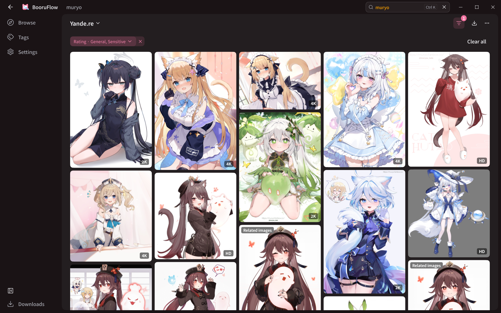
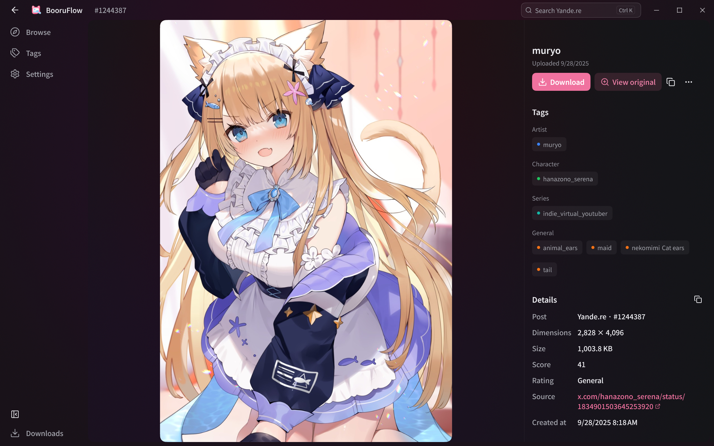
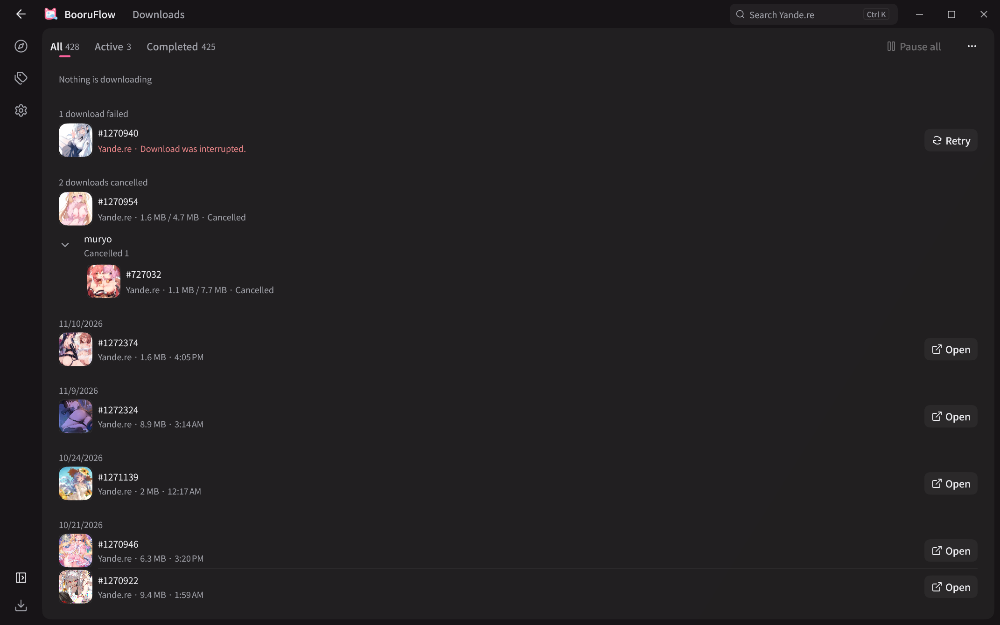
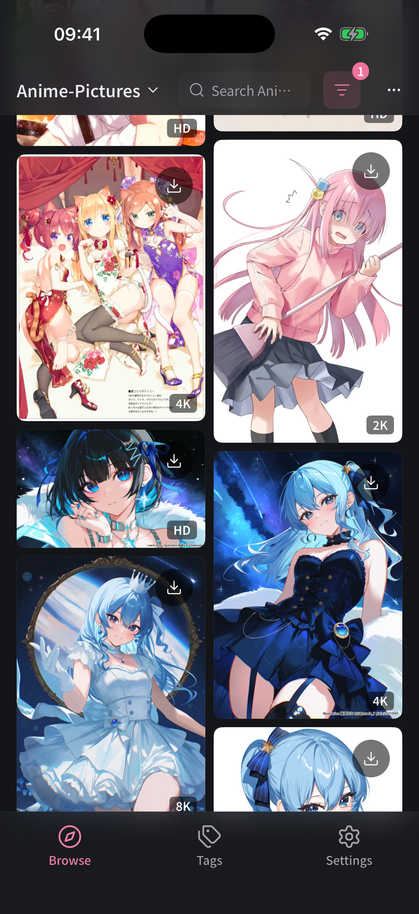
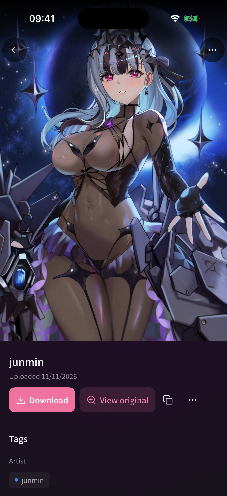

# BooruFlow

English | [Simplified Chinese](README_zh_cn.md)

**An open-source, cross-platform booru browser and image downloader.**

Search, browse, and download artwork from Danbooru, Gelbooru, Yande.re, and other image sources on Android, Windows, Linux, macOS, and iOS.

[Download](https://github.com/normalllll/yande_gui/releases/latest) | [Features](#features) | [Screenshots](#screenshots)

## Features

- **Multiple sources:** Yande.re, Konachan.net, Danbooru, AIBooru, Gelbooru, Wallhaven, and Anime-Pictures.
- **Search and discovery:** Tag search, rating filters, waterfall browsing, and popular posts where supported.
- **Image details:** View original images, tags, artist and source information, metadata, and related posts.
- **Download management:** Track progress, pause and resume tasks, retry failed downloads, and organize files by source.
- **Accounts and networking:** Configure accounts, proxies, and connection settings for each source.
- **Personalization:** Themes, layout settings, tag translations, and English, Simplified Chinese, Traditional Chinese, and Japanese interfaces.

## Download and install

Download packages from [GitHub Releases](https://github.com/normalllll/yande_gui/releases/latest).

| Platform | Package | Installation |
|---|---|---|
| Android | [app-arm64-v8a-release.apk](https://github.com/normalllll/yande_gui/releases/latest/download/app-arm64-v8a-release.apk) | Suitable for most current phones. Choose [app-universal-release.apk](https://github.com/normalllll/yande_gui/releases/latest/download/app-universal-release.apk) if unsure about your architecture |
| Windows | [windows-x64.zip](https://github.com/normalllll/yande_gui/releases/latest/download/windows-x64.zip) | Extract the archive and run the app |
| Linux | [linux_amd64.deb](https://github.com/normalllll/yande_gui/releases/latest/download/linux_amd64.deb), [linux_amd64.rpm](https://github.com/normalllll/yande_gui/releases/latest/download/linux_amd64.rpm), or [linux-x64.tar.gz](https://github.com/normalllll/yande_gui/releases/latest/download/linux-x64.tar.gz) | Choose the package for your distribution. Builds target Ubuntu 24.04; older systems may lack required libraries |
| macOS | [macos-universal-nosigned.zip](https://github.com/normalllll/yande_gui/releases/latest/download/macos-universal-nosigned.zip) | Supports Apple Silicon and Intel. The app is not notarized |
| iOS | [ios-nosigned.ipa](https://github.com/normalllll/yande_gui/releases/latest/download/ios-nosigned.ipa) | Requires signing before installation |

Android ARM32 and x86_64 packages are also available. Check the release assets for the packages included in each version.

## Contributing

Report bugs or suggest features in [Issues](https://github.com/normalllll/yande_gui/issues). For bugs, include your platform, image source, and steps to reproduce. Code, design, and translation contributions are welcome.

See the [development guide](DEVELOPMENT.md) for building, testing, and release instructions.

## Community

## Screenshots

### Desktop

|  |  |
|--------------------------------------------------------|--------------------------------------------------------|

### Mobile

|  |  |
|------------------------------------------------------|------------------------------------------------------|

## License

Licensed under the GNU General Public License v3.0. See [LICENSE](LICENSE).
